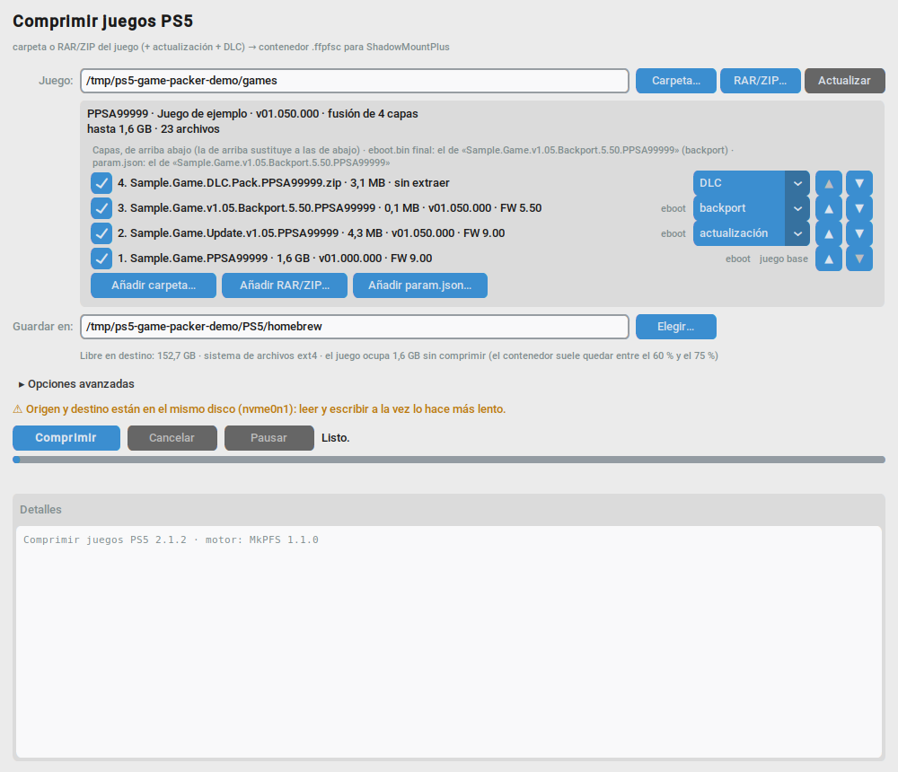
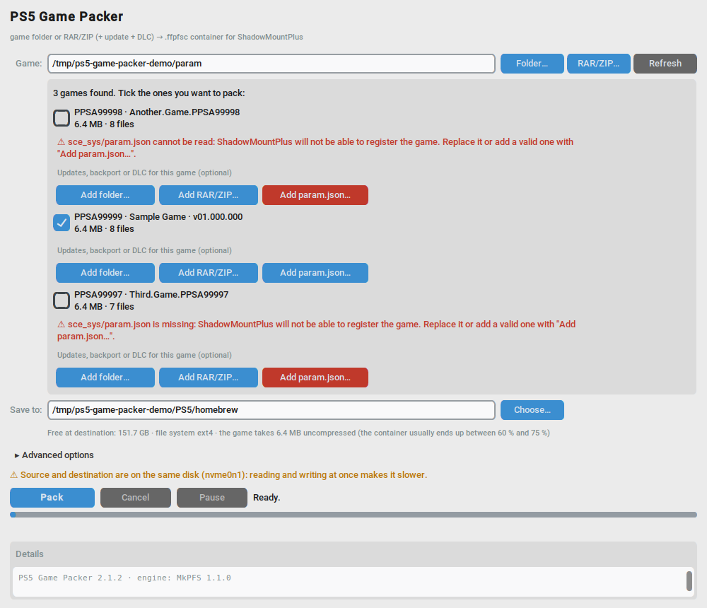
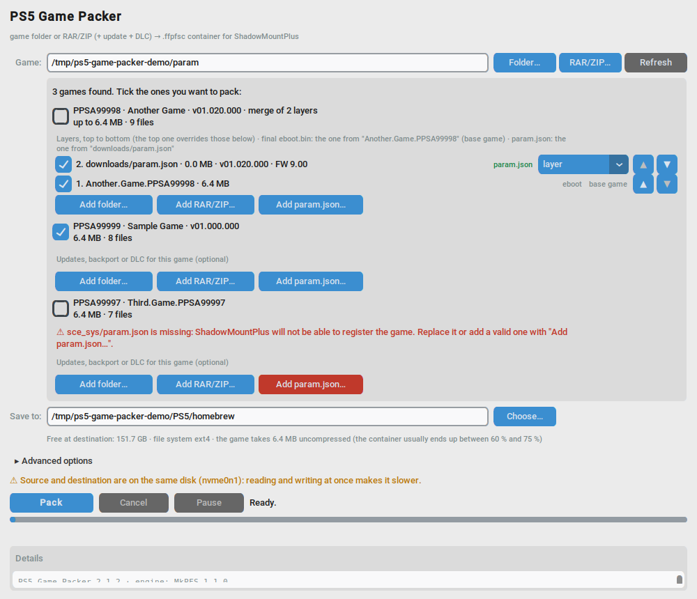
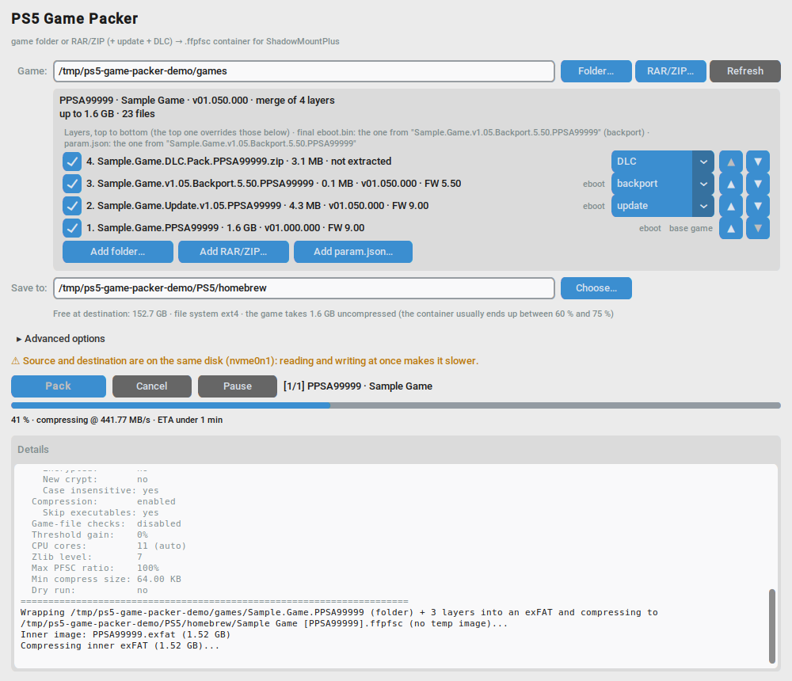
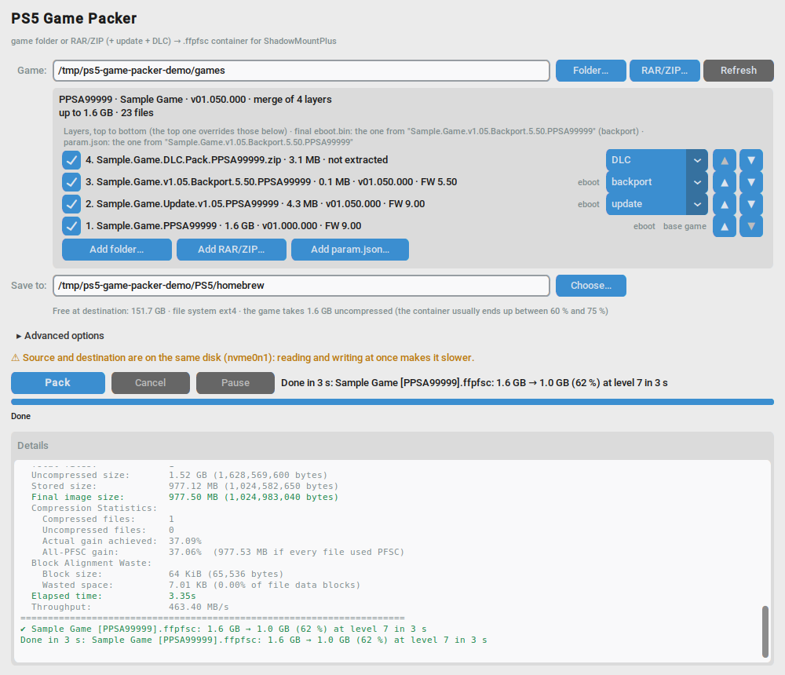

# PS5 Game Packer

[English](README.md)

Programa de escritorio que convierte una carpeta de juego de PS5, o el RAR/ZIP en el que venga, en un contenedor
`.ffpfsc` que [ShadowMountPlus](https://github.com/drakmor/ShadowMountPlus) monta en la consola. Lee el archivo sin
extraerlo y puede fusionar el juego base con sus actualizaciones, backport y DLC en un solo contenedor sin copiar
nada. Funciona en Windows y Linux, en inglés y español. El motor es [MkPFS](https://github.com/PSBrew/MkPFS), a
través de un fork que le añade la lectura de archivos y las capas (ver [Cambios en MkPFS](#cambios-en-mkpfs)).



## Requisitos

- Una PS5 con ShadowMountPlus. Lo que necesita la consola está en su README; este programa solo escribe el archivo
  del contenedor, nunca habla con ella.
- Un disco USB en exFAT. FAT32 no admite archivos de más de 4 GB. El contenedor va ahí, por ejemplo en la carpeta
  `homebrew`; dónde busca ShadowMountPlus está en su README.
- Windows 10 u 11 de 64 bits: nada más, el paquete lleva Python, MkPFS y UnRAR dentro.
- Linux: Python 3.10 o superior con tkinter, `git` para que el instalador baje el motor y, para los RAR, el `unrar`
  de RARLAB. El instalador no necesita sudo.
- macOS: sin probar, no se da soporte.

## Instalación

En Windows, descarga `ps5-game-packer-2.1.2-windows-x64.zip` de la
[página de versiones](https://github.com/raiddevel/ps5-game-packer/releases), descomprímelo donde quieras y abre
`ps5-game-packer.exe`. La primera vez SmartScreen puede decir que protegió el PC porque el ejecutable no está
firmado: "Más información" y "Ejecutar de todas formas". Si tu antivirus se queja del programa, que está hecho con
PyInstaller, añade la carpeta a sus exclusiones o construye el paquete tú mismo (abajo). La configuración se
guarda en `%APPDATA%\ps5-game-packer`, con el registro `log.txt` al lado.

En Linux:

```bash
sudo apt install python3-tk python3-venv unrar git     # Debian, Ubuntu, Mint
git clone https://github.com/raiddevel/ps5-game-packer.git
cd ps5-game-packer
./install.sh
```

El guion crea un venv en `~/.local/share/ps5-game-packer/venv` con el motor, CustomTkinter y pyzipper, y añade el
lanzador `~/.local/bin/ps5-game-packer`, la entrada del menú y el icono. Para actualizar, `git pull` y otra vez
`./install.sh`; con `--uninstall` quita lanzador, menú e icono. Tiene más opciones en `--help` (`--venv`,
`--python`, `--fork` para instalar el motor desde otro sitio). La configuración va a `~/.config/ps5-game-packer`.

Desde el repositorio, en cualquier sistema: un venv cuyo Python tenga tkinter, `pip install customtkinter pyzipper`
más el motor (`pip install "mkpfs @ git+https://github.com/raiddevel/MkPFS.git@layered-source"`) y
`python ps5-game-packer.py`.

## Paso a paso

1. Juego. Con "Carpeta..." o "RAR/ZIP..." eliges la carpeta del juego, su archivo, o una carpeta que tenga varios
   juegos al lado. Si el RAR va por partes, dale la primera; se lee sin extraerlo, así que no hace falta espacio
   extra. Valen también subcarpetas que guardan el archivo sin extraer, hasta dos niveles. "Actualizar" vuelve a
   analizar la misma ruta.
2. Contraseñas. Cuando un archivo está cifrado aparece un campo de contraseña; en un lote, cada archivo cifrado
   tiene el suyo en su tarjeta y el general vale para todos. Con una contraseña incorrecta la tarjeta sale en rojo
   y el lote sigue con los demás. Las contraseñas no se guardan.
3. Análisis. Cada tarjeta muestra TITLE_ID, título, versión, tamaño, número de archivos y si el juego es APR-EMU
   (MkPFS genera entonces su `ampr_emu.index` dentro del contenedor). Los `.pkg` que haya al lado se listan
   aparte: no se fusionan, se instalan después en la consola.
4. Capas. Si la carpeta tiene varias cosas del mismo TITLE_ID, el programa propone un solo contenedor con capas:
   juego base abajo, actualizaciones por versión, backport, DLC arriba. El papel se lee del nombre (update, patch,
   backport, dlc...) y, si no dice nada, del contenido: un `param.json` que exige un firmware más bajo es un
   backport, un `contentVersion` más alto una actualización, sin `eboot.bin` un DLC. Cada archivo se toma de la
   capa más alta que lo tenga y no se modifica nada. El marco dice de qué capa sale el `eboot.bin` final y avisa si
   un DLC o una actualización tapan el de un backport. Puedes reordenar, desmarcar, cambiar el papel o añadir
   capas desde otro sitio.
5. `param.json` roto o ausente. ShadowMountPlus registra el juego leyendo `sce_sys/param.json` de dentro del
   contenedor; hay volcados que vienen sin él o con uno truncado, y entonces el juego no aparece. La tarjeta lo
   avisa en rojo y el juego arranca desmarcado. Con "Añadir param.json..." eliges el correcto, de otro volcado del
   mismo juego, y entra como capa encima (se copia a una carpeta temporal del programa, que se borra al cerrar).

   

   
6. Guardar en. El disco USB de la PS5, por ejemplo su carpeta `homebrew`. El programa comprueba el espacio libre,
   rechaza FAT32 y avisa si origen y destino están en el mismo disco.
7. Opciones avanzadas, si quieres: nivel de compresión (7 por defecto; el 9 apenas reduce más y tarda más cuando el
   límite es el disco), núcleos, nombre del contenedor ("Título [ID]" o solo el ID), comprobar la imagen al
   terminar, el método antiguo de dos pasadas por si un juego no monta con el normal, carpeta temporal e idioma.
8. Comprimir. El contenedor se crea en el destino como `Título [TITLE_ID].ffpfsc`, con el título del `param.json`
   limpio para exFAT y Windows (sin acentos ni caracteres raros, 80 caracteres como mucho). Mientras se escribe
   existe como `.ffpfsc.tmp` y al terminar se renombra; si el proceso muere de golpe puede quedar ese `.tmp` en el
   USB, y se puede borrar. La barra muestra el porcentaje, la velocidad y el tiempo restante. "Pausar" detiene
   MkPFS sin perder nada y "Cancelar" borra el archivo a medias. El motor corre con prioridad baja y, en Linux, el
   programa lo pausa cuando el núcleo acumula demasiadas escrituras hacia un USB lento, para que el escritorio
   siga respondiendo. Al final la línea de estado resume cada contenedor: tamaño antes y después, porcentaje,
   nivel y tiempo. Lo mismo queda en `log.txt`, junto a la configuración.

   

   
9. En la consola. Conecta el disco, espera al aviso de unidad externa y deja que ShadowMountPlus registre el juego.
   Los `.pkg` del DLC se instalan después con el Package Installer, con el juego ya en la pantalla de inicio.
   Conserva los originales hasta haber probado el contenedor.

### Qué esperar

Medido con juegos reales en un PC de sobremesa escribiendo a un SSD USB, nivel 7:

| Origen | Contenedor | Tiempo |
|---|---|---|
| RAR de un volumen con 35 GB de juego dentro | 65 % | 4 min |
| RAR de un volumen con 48 GB de juego dentro | 63 % | 5 min |
| Base en RAR de 9 partes (90 GB) + DLC, fusionados | 43 % | 7 min 30 s |

La entrada va a 130-260 MB/s; el límite suele ser el disco de destino, así que el nivel 9 gana alrededor de un 1 %
sobre el 7. La mayoría de los juegos quedan entre el 60 % y el 75 % de su tamaño.

## Si la consola no registra un contenedor

ShadowMountPlus 1.7beta3 y beta4 pueden perder sus ganchos en SceShellCore tras el modo reposo, tras borrar juegos
o tras mucho tiempo encendida: los contenedores nuevos se montan pero no se registran y aparece "el puente
title_dir no está disponible". No es el contenedor. Apaga la consola del todo, no reposo, y vuelve a encenderla,
o actualiza ShadowMountPlus a 1.7beta5-fix1 o posterior, que recupera los ganchos solo. Los nombres con espacios o
corchetes no dan problema; el TITLE_ID se lee del `param.json` de dentro.

Si el contenedor se monta pero el juego no aparece nunca, mira el `sce_sys/param.json` del volcado: de ahí lee
ShadowMountPlus el TITLE_ID y el título, y hay volcados que vienen sin él o con uno truncado. El programa lo avisa
en rojo; arréglalo antes de comprimir con "Añadir param.json..." o sustituyéndolo en la carpeta de origen.

## Línea de órdenes

`--lang en|es`, `--version`, `--log ARCHIVO` para una copia del registro y, para pruebas,
`--auto ORIGEN CARPETA_DESTINO --start --quit-when-done`, con la contraseña general en la variable
`PS5_GAME_PACKER_PASSWORD`. En Linux los selectores de carpeta y archivo son los del escritorio, zenity o kdialog,
con el de Tk de reserva; `PS5_GAME_PACKER_DIALOGS=tk|zenity|kdialog` fuerza uno.

## Cómo funciona

La ventana es CustomTkinter y MkPFS corre como proceso aparte. `pack folder` construye el `.ffpfsc` con exFAT dentro
en una sola pasada; un RAR/ZIP se le pasa tal cual con `--archive-root` y la fusión es un `--layer` por capa, de
modo que el motor lista los archivos, sirve la vista fusionada y envía cada miembro en flujo sin extraer nada. El
contenido de los archivos se lee con la biblioteca de MkPFS. En Windows el motor es el `mkpfs.exe` que va junto al
programa y UnRAR se le indica con `MKPFS_UNRAR`.

El regulador de escrituras de Linux mira `Dirty` en `/proc/meminfo` y detiene MkPFS con SIGSTOP como mucho 15 s
seguidos, solo mientras el archivo de salida crece. Se detiene solo el proceso de MkPFS, nunca `unrar`, que pierde
datos si se le para mientras escribe en la tubería. El motor está fijado (`MKPFS_PIN` en
`ps5_game_packer/environment.py`, `install.sh` y `pyproject.toml`) a la rama `layered-source` del fork; cuando una
versión oficial incluya la lectura de archivos y las capas, bastará cambiar el pin. La ventana mira
`mkpfs pack folder --help` al arrancar y avisa si al motor instalado le falta algo.

## Cambios en MkPFS

MkPFS 1.1.0 empaqueta carpetas. Dos cosas que este programa necesita no están todavía en él, así que el motor se
instala desde un fork, [raiddevel/MkPFS](https://github.com/raiddevel/MkPFS), rama `layered-source`. El fork
conserva la licencia GPL-3.0 y la autoría de MkPFS; los cambios son pequeños, llevan pruebas y están propuestos a
MkPFS como pull requests, para quitarlos de aquí cuando una versión oficial los incluya. Son tres ramas:

- `archive-source`: empaquetar un juego directamente desde su RAR o ZIP, sin extraerlo. `mkpfs pack folder` acepta
  un `.rar` o `.zip` como origen, lista el archivo una vez, localiza la carpeta del juego dentro y envía cada
  miembro en flujo al constructor habitual. La imagen es la misma que daría la carpeta extraída. Cubre contraseñas
  (`--password` o `MKPFS_ARCHIVE_PASSWORD`), RAR por partes, archivos con varios juegos (`--archive-root`),
  `mkpfs batch` y el índice APR-EMU; los ZIP cifrados con AES necesitan el extra `mkpfs[archives]`. Los RAR se leen
  con la herramienta `unrar`. Un segundo commit arregla el listado de RAR: los conjuntos por partes se listan con
  `unrar lt -v`, los nombres se pasan a UnRAR.exe con barras invertidas en Windows y se saltan las cabeceras
  `Service` de los UnRAR nuevos. Módulo nuevo `mkpfs/archive_source.py` más los enganches en la CLI, el escritor
  exFAT y el índice AMPR.
- `layered-source`, sobre la anterior: fusionar actualizaciones y DLC al empaquetar, sin copiar. `--layer RUTA`,
  repetible de abajo arriba (`RUTA::CARPETA` elige la carpeta del juego dentro). Cada capa es una carpeta o un
  RAR/ZIP; un archivo de una capa superior sustituye al mismo de abajo y el resultado se envía en flujo al
  contenedor, byte a byte igual que la carpeta fusionada a mano. Módulo nuevo `mkpfs/layered_source.py` y una
  pequeña interfaz `SourceTree` común a archivos y capas. Es la rama que usa este programa.
- `archive-source-gui`, sobre la primera: la ventana propia de MkPFS también acepta archivos. Este programa no la
  usa.

Las tres pasan la batería de pruebas de MkPFS y `ruff`.

## Pruebas y paquete de Windows

`python -m pytest -q` con el Python del venv (hace falta pytest y el motor); las pruebas empaquetan un juego
sintético con el motor de verdad, también desde RAR reales y con capas, y comparan byte a byte. `tools/strings.py
locale/es.po` comprueba que el catálogo español está completo y `tools/screenshots.py` hace las capturas del README.
No hay ningún dato de juegos reales en el repositorio.

El paquete de Windows se construye en Windows con Python 3.12 y
`powershell -ExecutionPolicy Bypass -File packaging\windows.ps1`: crea un venv, pasa las pruebas, descarga UnRAR
de rarlab.com y deja `dist\ps5-game-packer-<versión>-windows-x64.zip`. `packaging\test-package.ps1 -Zip <zip>` lo
prueba de punta a punta con el juego sintético.

## Colaborar

Para cambios grandes, abre antes un issue. El código, los comentarios y los identificadores están en inglés; los
textos de la interfaz son los msgid en inglés y cada idioma más es un catálogo en `locale/` (el español es
`locale/es.po`). Pasa las pruebas antes de un pull request y no metas archivos de juegos reales, ni en pruebas ni en
capturas.

## Proyectos relacionados

- [MkPFS](https://github.com/PSBrew/MkPFS): el motor, con CLI, biblioteca y su propia interfaz. GPL-3.0.
- [ShadowMountPlus](https://github.com/drakmor/ShadowMountPlus): monta los contenedores en la consola y define lo
  que deben contener. GPL-3.0.
- [PS5 Game Compressor](https://github.com/juma-sayeh/PS5-Game-Compressor): comprime en la propia consola.
- [PS5 FFPFSC PRO](https://github.com/KINGDKAK/PS5-FFPFSC-PRO): otra interfaz sobre MkPFS.

## Aviso legal

Esto es una herramienta para empaquetar copias de seguridad de juegos que posees, para usarlas en tu propia
consola. No descifra, elude ni elimina ninguna protección, no contiene claves ni código propietario y no descarga
nada: solo lee sus orígenes y escribe un archivo nuevo. El proyecto no está afiliado a Sony Interactive
Entertainment ni respaldado por ella; "PlayStation" y "PS5" son marcas de Sony Interactive Entertainment Inc.,
citadas aquí solo para describir la compatibilidad. El software se entrega tal cual, sin garantía de ningún tipo:
úsalo bajo tu responsabilidad y conserva los archivos originales hasta haber comprobado el contenedor en la consola.

## Licencia y créditos

[GPL-3.0-or-later](LICENSE). Copyright (C) 2026 raiddevel.

Este programa existe gracias a MkPFS, de PSBrew (GPL-3.0), el motor que construye los contenedores y que corre
como proceso aparte, y a ShadowMountPlus, de drakmor (GPL-3.0), que es lo que monta los contenedores en la consola.
La ventana es [CustomTkinter](https://github.com/TomSchimansky/CustomTkinter) (MIT); los ZIP cifrados con AES
los lee [pyzipper](https://github.com/danifus/pyzipper) (MIT); en Windows, [psutil](https://github.com/giampaolo/psutil)
(BSD) pausa y reanuda el motor y `UnRAR.exe`, de [RARLAB](https://www.rarlab.com/rar_add.htm), se redistribuye
dentro del paquete con su licencia freeware. Python, Tcl/Tk y las bibliotecas de las que depende MkPFS tienen sus
textos en [LICENSES/](LICENSES/README.md), que viajan también dentro del paquete de Windows.
