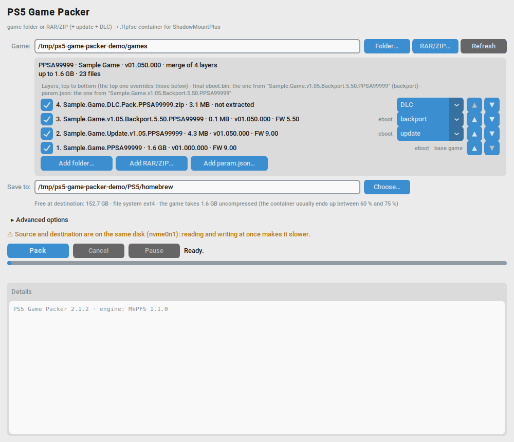

# PS5 Game Packer

[Español](README.es.md)

Desktop program that turns a PS5 game folder, or the RAR/ZIP it came in, into a `.ffpfsc` container that
[ShadowMountPlus](https://github.com/drakmor/ShadowMountPlus) mounts on the console. It reads the archive without
extracting it and can merge the base game with its updates, backport and DLC into a single container without copying
anything. It runs on Windows and Linux, in English and Spanish. The engine is [MkPFS](https://github.com/PSBrew/MkPFS),
through a fork that adds archive reading and layers (see [Changes to MkPFS](#changes-to-mkpfs)).



## Requirements

- A PS5 running ShadowMountPlus. What the console needs is in its README; this program only writes the container
  file, it never talks to the console.
- A USB drive formatted as exFAT. FAT32 cannot hold files over 4 GB. The container goes there, for example in the
  `homebrew` folder; where ShadowMountPlus looks is in its README.
- Windows 10 or 11, 64-bit: nothing else, the package carries Python, MkPFS and UnRAR inside.
- Linux: Python 3.10 or newer with tkinter, `git` so that the installer can fetch the engine and, for RAR archives,
  `unrar` from RARLAB. The installer needs no sudo.
- macOS: untested, not supported.

## Installation

On Windows, download `ps5-game-packer-2.1.3-windows-x64.zip` from the
[releases page](https://github.com/raiddevel/ps5-game-packer/releases), unzip it anywhere and open
`ps5-game-packer.exe`. The first time, SmartScreen may say it protected your PC because the executable is not signed:
"More info", then "Run anyway". If your antivirus complains about the program, which is built with PyInstaller, add
the folder to its exclusions or build the package yourself (below). Settings are kept in `%APPDATA%\ps5-game-packer`,
with the `log.txt` log next to them.

On Linux:

```bash
sudo apt install python3-tk python3-venv unrar git     # Debian, Ubuntu, Mint
git clone https://github.com/raiddevel/ps5-game-packer.git
cd ps5-game-packer
./install.sh
```

The script creates a venv at `~/.local/share/ps5-game-packer/venv` with the engine, CustomTkinter and pyzipper, and
adds the launcher `~/.local/bin/ps5-game-packer`, the menu entry and the icon. To update, `git pull` and `./install.sh`
again; `--uninstall` removes the launcher, menu entry and icon. It has more options in `--help` (`--venv`, `--python`,
`--fork` to install the engine from somewhere else). Settings go to `~/.config/ps5-game-packer`.

From the repository, on any system: a venv whose Python has tkinter, `pip install customtkinter pyzipper` plus the
engine (`pip install "mkpfs @ git+https://github.com/raiddevel/MkPFS.git@layered-source"`) and
`python ps5-game-packer.py`.

## Step by step

1. Game. With "Folder..." or "RAR/ZIP..." you choose the game folder, its archive, or a folder with several games
   side by side. If the RAR comes in parts, give it the first one; it is read without extracting, so no extra space
   is needed. Subfolders that keep the unextracted archive work too, down to two levels. "Refresh" scans the same
   path again.
2. Passwords. When an archive is encrypted a password field appears; in a batch, each encrypted archive has its own
   on its card and the general one applies to all. With a wrong password the card turns red and the batch goes on
   with the rest. Passwords are never saved.
3. Scan. Each card shows TITLE_ID, title, version, size, number of files and whether the game is APR-EMU (MkPFS
   then generates its `ampr_emu.index` inside the container). Any `.pkg` found next to the game is listed apart: it
   is not merged, you install it on the console afterwards.
4. Layers. If the folder holds several things with the same TITLE_ID, the program proposes a single container with
   layers: base game at the bottom, updates by version, backport, DLC on top. The role is read from the name
   (update, patch, backport, dlc...) and, if that says nothing, from the contents: a `param.json` that asks for a
   lower firmware is a backport, a higher `contentVersion` is an update, no `eboot.bin` is a DLC. Each file is
   taken from the highest layer that has it and nothing is modified. The frame says which layer the final
   `eboot.bin` comes from and warns if a DLC or an update covers the one from a backport. You can reorder, untick,
   change the role or add layers from somewhere else.
5. Broken or missing `param.json`. ShadowMountPlus registers the game by reading `sce_sys/param.json` from inside
   the container; some dumps come without it or with a truncated one, and then the game never shows up. The card
   warns in red and the game starts unticked. With "Add param.json..." you choose the right one, from another dump
   of the same game, and it goes in as a layer on top (it is copied to a temporary folder of the program, deleted
   on exit).

   

   
6. Save to. The PS5 USB drive, for example its `homebrew` folder. The program checks the free space, rejects FAT32
   and warns if source and destination are on the same disk.
7. Advanced options, if you want them: compression level (7 by default; 9 barely shrinks more and takes longer when
   the disk is the limit), CPU cores, container name ("Title [ID]" or just the ID), verify the image when done, the
   legacy two-pass method in case a game does not mount with the normal one, temporary folder and language.
8. Pack. The container is created at the destination as `Title [TITLE_ID].ffpfsc`, with the title from `param.json`
   cleaned for exFAT and Windows (no accents or odd characters, 80 characters at most). While it is being written it
   exists as `.ffpfsc.tmp` and is renamed at the end; if the process dies suddenly that `.tmp` may be left on the
   USB drive, and it can be deleted. The bar shows the percentage, the speed and the time left. "Pause" stops MkPFS
   without losing anything and "Cancel" deletes the half-written file. The engine runs at low priority and, on
   Linux, the program pauses it when the kernel piles up too many writes towards a slow USB drive, so that the
   desktop keeps responding. At the end the status line sums up each container: size before and after, percentage,
   level and time. The same goes to `log.txt`, next to the settings.

   

   
9. On the console. Plug in the drive, wait for the external drive notice and let ShadowMountPlus register the game.
   The DLC `.pkg` files are installed afterwards with the Package Installer, once the game is on the home screen.
   Keep the originals until you have tried the container.

### What to expect

Measured with real games on a desktop PC writing to a USB SSD, level 7:

| Source | Container | Time |
|---|---|---|
| Single-volume RAR with 35 GB of game inside | 65 % | 4 min |
| Single-volume RAR with 48 GB of game inside | 63 % | 5 min |
| Base in a 9-part RAR (90 GB) + DLC, merged | 43 % | 7 min 30 s |

Input runs at 130-260 MB/s; the limit is usually the destination disk, so level 9 gains about 1 % over 7. Most games
end up between 60 % and 75 % of their size.

## If the console does not register a container

ShadowMountPlus 1.7beta3 and beta4 can lose their hooks into SceShellCore after rest mode, after deleting games or
after a long time on: new containers get mounted but not registered and "title_dir bridge unavailable" shows up. It
is not the container. Shut the console down completely, not rest mode, and turn it on again, or update
ShadowMountPlus to 1.7beta5-fix1 or later, which recovers the hooks by itself. Names with spaces or brackets are no
problem; the TITLE_ID is read from the `param.json` inside.

If the container mounts but the game never shows up, look at the dump's `sce_sys/param.json`: that is where
ShadowMountPlus reads the TITLE_ID and the title, and some dumps come without it or with a truncated one. The program
warns in red; fix it before packing with "Add param.json..." or by replacing it in the source folder.

## Command line

`--lang en|es`, `--version`, `--log FILE` for a copy of the log and, for testing,
`--auto SOURCE DESTINATION --start --quit-when-done`, with the general password in the `PS5_GAME_PACKER_PASSWORD`
variable. On Linux the folder and file pickers are the desktop's, zenity or kdialog, with Tk as fallback;
`PS5_GAME_PACKER_DIALOGS=tk|zenity|kdialog` forces one.

## How it works

The window is CustomTkinter and MkPFS runs as a separate process. `pack folder` builds the `.ffpfsc` with exFAT
inside in a single pass; a RAR/ZIP is handed to it as is with `--archive-root` and a merge is one `--layer` per
layer, so the engine lists the files, serves the merged view and streams each member without extracting anything.
The contents of archives are read with the MkPFS library. On Windows the engine is the `mkpfs.exe` next to the
program and UnRAR is pointed to it with `MKPFS_UNRAR`.

The Linux write throttle watches `Dirty` in `/proc/meminfo` and stops MkPFS with SIGSTOP for at most 15 s at a time,
only while the output file is growing. Only the MkPFS process is stopped, never `unrar`, which loses data if it is
stopped while writing to the pipe. The engine is pinned (`MKPFS_PIN` in `ps5_game_packer/environment.py`,
`install.sh` and `pyproject.toml`) to the `layered-source` branch of the fork; when an official release includes
archive reading and layers, changing the pin will be enough. The window looks at `mkpfs pack folder --help` on
start-up and warns if the installed engine lacks something.

## Changes to MkPFS

MkPFS 1.1.0 packs folders. Two things this program needs are not in it yet, so the engine is installed from a fork,
[raiddevel/MkPFS](https://github.com/raiddevel/MkPFS), branch `layered-source`. The fork keeps the GPL-3.0 license
and the authorship of MkPFS; the changes are small, come with tests and are proposed to MkPFS as pull requests (issue [#138](https://github.com/PSBrew/MkPFS/issues/138);
pull requests [#139](https://github.com/PSBrew/MkPFS/pull/139), [#140](https://github.com/PSBrew/MkPFS/pull/140) and [#141](https://github.com/PSBrew/MkPFS/pull/141)), to drop them from here once an official release
includes them. There are three branches:

- `archive-source`: pack a game straight from its RAR or ZIP, without extracting it. `mkpfs pack folder` accepts a
  `.rar` or `.zip` as source, lists the archive once, finds the game folder inside and streams each member to the
  usual builder. The image is the same the extracted folder would give. It covers passwords (`--password` or
  `MKPFS_ARCHIVE_PASSWORD`), multi-volume RAR sets, archives holding several games (`--archive-root`), `mkpfs
  batch` and the APR-EMU index; AES-encrypted ZIPs need the `mkpfs[archives]` extra. RAR archives are read through
  the `unrar` tool. A second commit fixes the RAR listing: multi-volume sets are listed with `unrar lt -v`, names are
  passed to UnRAR.exe with backslashes on Windows and the `Service` headers of newer UnRAR versions are skipped. New
  module `mkpfs/archive_source.py` plus the hooks in the CLI, the exFAT writer and the AMPR index. Pull request [#139](https://github.com/PSBrew/MkPFS/pull/139).
- `layered-source`, on top of the previous one: merge updates and DLC while packing, without copying. `--layer PATH`,
  repeatable from bottom to top (`PATH::FOLDER` picks the game folder inside). Each layer is a folder or a RAR/ZIP;
  a file in a higher layer replaces the same one below and the result is streamed to the container, byte for byte
  the same as the folder merged by hand. New module `mkpfs/layered_source.py` and a small `SourceTree` interface
  shared by archives and layers. This is the branch the program uses. Pull request [#141](https://github.com/PSBrew/MkPFS/pull/141).
- `archive-source-gui`, on top of the first one: MkPFS's own window accepts archives too. This program does not use
  it. Pull request [#140](https://github.com/PSBrew/MkPFS/pull/140).

All three pass the MkPFS test suite and `ruff`.

## Tests and the Windows package

`python -m pytest -q` with the venv's Python (it needs pytest and the engine); the tests pack a synthetic game with
the real engine, also from real RAR files and with layers, and compare byte by byte. `tools/strings.py locale/es.po`
checks that the Spanish catalog is complete and `tools/screenshots.py` makes the README screenshots. There is no data
from real games in the repository.

The Windows package is built on Windows with Python 3.12 and
`powershell -ExecutionPolicy Bypass -File packaging\windows.ps1`: it creates a venv, runs the tests, downloads UnRAR
from rarlab.com and leaves `dist\ps5-game-packer-<version>-windows-x64.zip`. `packaging\test-package.ps1 -Zip <zip>`
tests it end to end with the synthetic game.

## Contributing

For big changes, open an issue first. Code, comments and identifiers are in English; the interface texts are the
msgids and every other language is a catalog in `locale/` (Spanish is `locale/es.po`). Run the tests before a pull
request and do not add files from real games, neither in tests nor in screenshots.

## Related projects

- [MkPFS](https://github.com/PSBrew/MkPFS): the engine, with a CLI, a library and its own window. GPL-3.0.
- [ShadowMountPlus](https://github.com/drakmor/ShadowMountPlus): mounts the containers on the console and defines
  what they must hold. GPL-3.0.
- [PS5 Game Compressor](https://github.com/juma-sayeh/PS5-Game-Compressor): compresses on the console itself.
- [PS5 FFPFSC PRO](https://github.com/KINGDKAK/PS5-FFPFSC-PRO): another front end for MkPFS.

## Legal notice

This is a tool to package backups of games you own, for use on your own console. It does not decrypt, bypass or
remove any protection, contains no keys or proprietary code and downloads nothing: it only reads its sources and
writes a new file. The project is not affiliated with or endorsed by Sony Interactive Entertainment; "PlayStation"
and "PS5" are trademarks of Sony Interactive Entertainment Inc., named here only to describe compatibility. The
software is provided as is, without warranty of any kind: use it at your own risk, and keep your original files
until the container has been verified on the console.

## License and credits

[GPL-3.0-or-later](LICENSE). Copyright (C) 2026 raiddevel.

This program exists thanks to MkPFS, by PSBrew (GPL-3.0), the engine that builds the containers and runs as a
separate process, and to ShadowMountPlus, by drakmor (GPL-3.0), which is what mounts the containers on the console.
The window is [CustomTkinter](https://github.com/TomSchimansky/CustomTkinter) (MIT); AES-encrypted ZIPs are read with
[pyzipper](https://github.com/danifus/pyzipper) (MIT); on Windows, [psutil](https://github.com/giampaolo/psutil)
(BSD) pauses and resumes the engine and `UnRAR.exe`, from [RARLAB](https://www.rarlab.com/rar_add.htm), is
redistributed inside the package under its freeware license. Python, Tcl/Tk and the libraries MkPFS depends on have
their texts in [LICENSES/](LICENSES/README.md), which also travel inside the Windows package.
